# Hamza Akil Khan

**Full-Stack Developer &bull; MERN Stack &bull; AI-Powered Applications**  
Mumbai, India &nbsp;&bull;&nbsp; [LinkedIn](https://www.linkedin.com/in/hamza-khan-47a604347) &nbsp;&bull;&nbsp; [GitHub Repositories](https://github.com/hamzaKhan2004?tab=repositories) &nbsp;&bull;&nbsp; [khanhamzatz@gmail.com](mailto:khanhamzatz@gmail.com)

  

## About Me

I am a Computer Engineering student focused on building robust full-stack applications, scalable backend architectures, and AI-powered systems. I enjoy understanding how software works internally &mdash; from component reconciliation and custom CLI engines to distributed cloud deployments and retrieval-augmented generation (RAG) pipelines. Currently focused on shipping reliable software from first principles.

## Technical Skills

- **Languages:** JavaScript (ES6+), TypeScript, Java, SQL
- **Frontend:** React.js, Next.js, Tailwind CSS, Redux Toolkit, GSAP, HTML5, CSS3
- **Backend:** Node.js, Express.js, REST APIs, MongoDB, Mongoose, MySQL, Redis
- **AI &amp; LLM:** Gemini AI, LangChain, LangGraph, RAG, Tavily Search, Vector Databases
- **Cloud &amp; Tools:** AWS (S3, EC2, Amplify), Docker, Git, GitHub, Postman

## Featured Projects

### 1. Nova Search
AI-powered search engine with real-time web retrieval and an automated multi-model evaluation pipeline.
- **Highlights:** MERN stack with native Gemini AI integration, LangChain, LangGraph, RAG, and Tavily-based search; automated response evaluation using a judge LLM; JWT authentication and email workflows.
- **Technologies:** React, Node.js, Express, MongoDB, Gemini AI, LangChain, LangGraph, RAG, Tavily
- **Links:** [Live Demo](https://nova-search-frontend.onrender.com/) &bull; [Repository](https://github.com/hamzaKhan2004/Nova-Search)

### 2. CodeHub / GitForge
GitHub-inspired code collaboration and version control platform.
- **Highlights:** End-to-end repository management; custom Yargs CLI implementing core Git operations (`init`, `commit`, `push`, `pull`); Amazon S3 object storage; automated continuous deployment on AWS Amplify.
- **Technologies:** React, Node.js, Express, AWS S3, AWS Amplify, Yargs, REST APIs
- **Links:** [Live Demo](https://main.d31x320hv8k13m.amplifyapp.com/) &bull; [Repository](https://github.com/hamzaKhan2004/CodeHub)

### 3. React Dooms
Lightweight React-like UI framework built from scratch using TypeScript and object-oriented programming.
- **Highlights:** Custom virtual component architecture, reactive state management, lifecycle handling, DOM event delegation, and reconciliation; includes an Avengers-themed countdown demo application.
- **Technologies:** TypeScript, OOP Architecture, Virtual DOM Reconciliation, State Management, Esbuild
- **Links:** [Repository](https://github.com/hamzaKhan2004/React-Dooms)

## Achievements &amp; Education

- **Second Prize &mdash; Technical Paper Presentation**, Viva Institute of Technology
- **Second Prize &mdash; Frontend Development Competition**, Viva Institute of Technology
- **Bachelor of Engineering in Computer Science and Engineering**, Viva Institute of Technology, Mumbai (Expected 2026)

---

  "Building useful applications, exploring new technologies, and learning by shipping."

