  

  <h1>Hamza Akil Khan</h1>

  

    <strong>Full-Stack Developer &nbsp;&bull;&nbsp; MERN Stack &nbsp;&bull;&nbsp; AI-Powered Applications</strong>
     
    Mumbai, India
  

  

    <a href="https://github.com/hamzaKhan2004?tab=repositories">
      <strong>Repositories</strong>
    </a>
    &nbsp;&bull;&nbsp;
    <a href="https://www.linkedin.com/in/hamza-khan-47a604347">
      <strong>LinkedIn</strong>
    </a>
    &nbsp;&bull;&nbsp;
    <a href="mailto:khanhamzatz@gmail.com">
      <strong>khanhamzatz@gmail.com</strong>
    </a>
  

  

    Computer Engineering student passionate about engineering robust web applications, exploring generative AI workflows, and understanding how software systems function internally &mdash; from component reconciliation and custom CLI engines to distributed cloud deployments and retrieval-augmented generation pipelines.
  

---

### 🛠️ Technical Stack

| Category | Technologies &amp; Tools |
| :--- | :--- |
| **Languages** | `JavaScript (ES6+)` `TypeScript` `Java` `SQL` |
| **Frontend** | `React.js` `Next.js` `Tailwind CSS` `Redux Toolkit` `GSAP` `HTML5` `CSS3` |
| **Backend &amp; DB** | `Node.js` `Express.js` `REST APIs` `MongoDB` `Mongoose` `MySQL` `Redis` |
| **AI &amp; LLM** | `Gemini AI` `LangChain` `LangGraph` `RAG` `Tavily Search` `Vector Databases` |
| **Cloud &amp; Tools** | `AWS (S3, EC2, Amplify)` `Docker` `Git` `GitHub` `Postman` |

---

### 🚀 Featured Projects

#### 1. [Nova Search](https://github.com/hamzaKhan2004/Nova-Search)
> **AI-powered search engine with real-time web retrieval and automated multi-model evaluation**

* Built on the **MERN stack** integrated natively with **Gemini AI** to deliver synthesized, cited answers from live queries.
* Orchestrated conversational workflows with **LangChain**, **LangGraph**, **RAG**, and **Tavily Search API**.
* Engineered an automated evaluation pipeline using a judge LLM to benchmark response quality across model variants.
* Secured with **JWT authentication** and automated email notification workflows.
* **Stack**: `React` &bull; `Node.js` &bull; `Express` &bull; `MongoDB` &bull; `Gemini AI` &bull; `LangChain` &bull; `LangGraph` &bull; `RAG` &bull; `Tavily`
* **Links**: [Live Demo](https://nova-search-frontend.onrender.com/) &nbsp;|&nbsp; [Repository](https://github.com/hamzaKhan2004/Nova-Search)

 

#### 2. [GitForge / CodeHub](https://github.com/hamzaKhan2004/CodeHub)
> **GitHub-inspired code collaboration platform with custom version-control CLI**

* Implemented end-to-end repository management and code collaboration capabilities from first principles.
* Developed a custom CLI using **Yargs** supporting core Git primitives (`init`, `commit`, `push`, `pull`).
* Utilized **Amazon S3** for secure, high-durability repository snapshot and object storage.
* Configured automated continuous deployment via **AWS Amplify**.
* **Stack**: `React` &bull; `Node.js` &bull; `Express` &bull; `AWS S3` &bull; `AWS Amplify` &bull; `Yargs` &bull; `REST APIs`
* **Links**: [Live Demo](https://main.d31x320hv8k13m.amplifyapp.com/) &nbsp;|&nbsp; [Repository](https://github.com/hamzaKhan2004/CodeHub)

 

#### 3. [React Dooms](https://github.com/hamzaKhan2004/React-Dooms)
> **Lightweight React-like UI framework built from scratch with TypeScript and OOP**

* Architected a modular component lifecycle and virtual rendering engine to study UI reconciliation mechanics.
* Applied object-oriented programming patterns: encapsulated state containers, class inheritance, and DOM event delegation.
* Created reactive state update loops and lightweight virtual tree reconciliation.
* Built an Avengers-themed interactive countdown application to showcase and stress-test framework capabilities.
* **Stack**: `TypeScript` &bull; `OOP Architecture` &bull; `DOM Reconciliation` &bull; `State Management` &bull; `Esbuild`
* **Links**: [Repository](https://github.com/hamzaKhan2004/React-Dooms)

---

### 📈 Open-Source Activity

---

### 🏆 Achievements &amp; Education

| 🏅 Honors &amp; Competitions | 🎓 Education |
| :--- | :--- |
| **Second Prize** &mdash; Technical Paper Presentation Viva Institute of Technology | **Bachelor of Engineering in Computer Science and Engineering** Viva Institute of Technology, Mumbai &bull; 2026 |
| **Second Prize** &mdash; Frontend Development Competition Viva Institute of Technology | |

---

*"Building useful applications, exploring new technologies, and learning by shipping."*

 

&copy; 2026 Hamza Akil Khan

